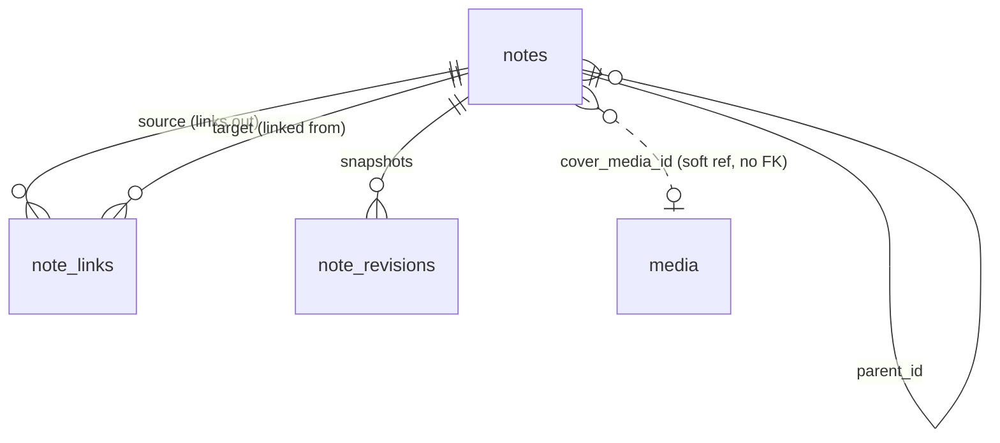

# Schema

Postgres 18. Five tables, three views, three triggers, seven callable functions.
The model is documented in `docs/decisions.md`; this file is the implementation.

Apply with `pnpm --filter api db:migrate`, rebuild from nothing with `db:reset`.
`reset.ts` refuses any database whose URL is not local unless `ALLOW_REMOTE_RESET=1`.

---

## Entity relationships



`cover_media_id` deliberately has **no foreign key** — media rows can be deleted
independently and a dangling cover should degrade to "no cover", not block the delete.
The API validates it on write.

---

## Enums

| Type | Values | Used by |
|---|---|---|
| `note_kind` | `note`, `page`, `project` | `notes.kind`, `note_revisions.status` (no), `search_notes.kind` |
| `note_status` | `draft`, `published`, `archived` | `notes.status`, `note_revisions.status` |

`page` is for About / Now / Uses; `project` for things like Daydrops. They live in the
same table because in a wiki every public thing is a note.

---

## Tables

### `notes`

| Column | Type | Notes |
|---|---|---|
| `id` | `uuid` | `gen_random_uuid()` |
| `slug` | `text` | `UNIQUE`, 96 chars max, derived by `slugify()` |
| `title` | `text` | |
| `body` | `text` | Markdown, contains `[[slug]]` wiki links |
| `excerpt` | `text` | nullable; weighted `B` in search |
| `kind` | `note_kind` | default `note` |
| `status` | `note_status` | default `draft` |
| `parent_id` | `uuid` | self-FK, `ON DELETE SET NULL` |
| `cover_media_id` | `uuid` | soft reference to `media.id`, no FK |
| `published_at` | `timestamptz` | **first** publish only; survives unpublish |
| `created_at` / `updated_at` | `timestamptz` | `updated_at` maintained by trigger |
| `deleted_at` | `timestamptz` | soft delete; every read path filters it |
| `reading_minutes` | `int` | set by `create_note`, **not** generated |
| `search_vector` | `tsvector` | `GENERATED ALWAYS ... STORED` |

`search_vector` weights: title `A`, excerpt `B`, body `C`, built with
`to_tsvector('english', …)` — immutable, so it is legal in a generated column.
`reading_minutes` is not generated because word-splitting and `unaccent` are not
immutable, so it is computed in `create_note` instead.

Indexes: `UNIQUE(slug)` (from the constraint), `(status, updated_at DESC)`,
`GIN(search_vector)`, `GIN(slug gin_trgm_ops)`, `(parent_id)`.

### `note_links`

| Column | Type | Notes |
|---|---|---|
| `source_id` | `uuid` | FK → `notes`, `ON DELETE CASCADE` |
| `target_id` | `uuid` | FK → `notes`, `ON DELETE CASCADE` |

`PRIMARY KEY (source_id, target_id)` — one edge per pair, duplicate `[[slug]]`
mentions collapse. `note_links_target_idx` on `target_id` is what makes "Linked from"
a lookup instead of a scan.

### `note_revisions`

Immutable snapshots of the **old** row, written by `capture_revision`.

| Column | Type | Notes |
|---|---|---|
| `id` | `uuid` | |
| `note_id` | `uuid` | FK → `notes`, `ON DELETE CASCADE` |
| `title`, `body`, `excerpt`, `status` | | the snapshot |
| `created_at` | `timestamptz` | when the edit happened |
| `created_by` | `text` | nullable; unused until auth lands |

Index `(note_id, created_at DESC)` — newest-first per note is a forward scan.

### `media`

| Column | Type | Notes |
|---|---|---|
| `id` | `uuid` | |
| `r2_key` | `text` | `UNIQUE`; the object key in R2 |
| `url` | `text` | public URL |
| `mime`, `bytes`, `width`, `height`, `alt` | | metadata |
| `created_at` | `timestamptz` | |

### `schema_migrations`

| Column | Type | Notes |
|---|---|---|
| `version` | `text` | PK; the filename without `.sql` |
| `applied_at` | `timestamptz` | |

Because versions are filenames, **editing an applied migration never re-runs it**.
Fixes ship as new files (`0018`, `0019`).

---

## Triggers

### `notes_set_updated_at` — `BEFORE UPDATE`

Sets `NEW.updated_at := now()` unconditionally.

**Consequence:** you cannot backdate a note with a plain `UPDATE`; the trigger
overwrites it. The seed disables `USER` triggers around its date backfill for exactly
this reason (DDL is transactional, so the `ALTER`s roll back if the block raises).

### `notes_capture_revision` — `AFTER UPDATE OF title, body, excerpt, status`

Inserts the **OLD** row into `note_revisions` only when the tuple
`(title, body, excerpt, status)` is distinct. Because the guard is a tuple comparison,
`UPDATE notes SET body = body` writes no revision. `restore_revision` is therefore
undoable: restoring an old snapshot records the current state as a new snapshot.

### `notes_reindex_links` — `AFTER INSERT OR UPDATE OF body`

Deletes this note's outgoing edges, then re-derives them:

```sql
INSERT INTO note_links (source_id, target_id)
SELECT DISTINCT NEW.id, n.id
FROM regexp_matches(NEW.body, '\[\[([a-z0-9-]+)\]\]', 'g') AS m(slug)
JOIN notes n ON n.slug = m[1]
WHERE n.id <> NEW.id
ON CONFLICT DO NOTHING;
```

Two consequences worth knowing:

- **Unresolved targets are dropped silently.** A typo'd `[[noww]]` leaves no edge and
  renders as text. The editor is responsible for warning (Phase 10).
- **Forward references don't resolve at insert time.** A note that links to a note
  created later in the same script loses that edge. The seed rebuilds the whole graph
  after every note exists.

---

## Functions

| Function | Returns | What it does |
|---|---|---|
| `slugify(text)` | `text` | lower + `unaccent`, non-alphanumerics → `-`, trims dashes, 96-char cap, `untitled` fallback. `STABLE`, not `IMMUTABLE` (calls `unaccent`). |
| `create_note(title, body, kind, parent_slug)` | `notes` | Rejects reserved slugs and `_`-prefixed names; resolves parent strictly (a typo'd parent raises); computes `reading_minutes` as `ceil(words/200)`, min 1; retries slug collisions as `-2`, `-3` … up to 100. |
| `publish_note(slug)` | `notes` | 404-equivalent if missing or soft-deleted; raises if `btrim(body) = ''`; sets `status='published'` and `published_at = COALESCE(published_at, now())` so the **first** publish date is preserved forever. |
| `unpublish_note(slug)` | `notes` | `published → draft`. Deliberately does **not** clear `published_at`. |
| `search_notes(q, lim, off)` | `TABLE(...)` | `websearch_to_tsquery('english', q)`, ranked by `ts_rank_cd(vector, query, 32)`, with a `ts_headline` snippet wrapped in `<mark>`. Published, non-deleted only. |
| `note_page(slug)` | `jsonb` | One round trip for a whole page: `note`, `backlinks`, `outgoing`, `children`. Backlinks and children are published-only; the note itself is **not** filtered by status, so the editor can preview a draft. |
| `restore_revision(rev_id)` | `notes` | Writes a snapshot back onto the note. Refuses if the note is soft-deleted. |

Trigger functions (`set_updated_at`, `capture_revision`, `reindex_note_links`) are not
called directly and take no arguments.

---

## Views

| View | Rows | Shape |
|---|---|---|
| `directory` | published, non-deleted | `slug, title, kind, updated_at, reading_minutes`, `ORDER BY title` |
| `wiki_stats` | one row **per kind** | `kind, note_count, total_reading_minutes` |
| `note_backlinks` | edges where both ends are published | `target_slug/title`, `source_slug/title` |

`wiki_stats` is per-kind, so "10 notes · 4 pages · 1 project" on the home page is
either three lookups or a `SUM` in the API. It is not a single totals row.

`directory` was originally ordered by `updated_at DESC`; `0019` changed it to `title`
so it behaves like a directory. Recency belongs to the home page's "recently updated"
list, which queries `notes` directly.

---

## Invariants

1. **Every edge points at an existing note.** Edges are rebuilt from `slug` matches, so
   deleting a target removes its inbound edges via `ON DELETE CASCADE`.
2. **Backlinks never leak drafts.** `note_backlinks` and `note_page` filter both ends by
   `status = 'published'`.
3. **`published_at` is first-publish, not last-update.** Use `updated_at` for recency.
4. **`reading_minutes` is only computed by `create_note`.** A `PATCH` that changes
   `body` must recompute it (or call a function that does) — otherwise the value goes
   stale. This is the one place Phase 5 can quietly get it wrong.
5. **Soft delete wins.** Every read path filters `deleted_at IS NULL`; nothing is ever
   hard-deleted except by cascade from a `notes` row.

## Gotchas

- **Generated columns need `IMMUTABLE`.** `now()`, `unaccent()` and
  `regexp_split_to_array` are not safe there. `to_tsvector('english', …)` is.
- **`regexp_matches` returns `text[]`.** Match on `m[1]`, not `m.slug` — the alias names
  the row, not the capture group.
- **Delete before insert in the link trigger**, or stale edges survive an edit.
- **Reserved slugs** (`0018`): `new, edit, delete, admin, api, auth, login, logout,
  signup, search, settings, index, directory, 404, rss, rss-xml, sitemap,
  sitemap-index, sitemap-index-xml`, plus anything starting with `_`.
- **No `SECURITY DEFINER` functions** are used yet. If one is added, pin
  `SET search_path = public, pg_temp`.
